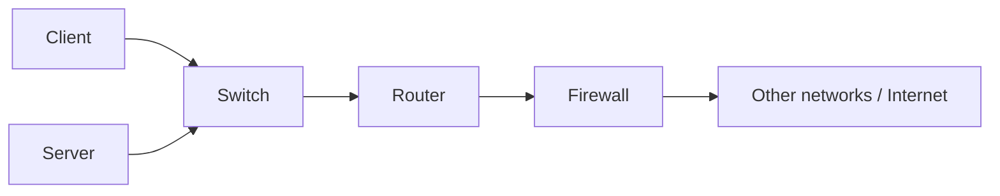

# Day 01 — Network Devices

[[00 - CCNA Home|CCNA Home]] · [[01 - Lessons/02 - Interfaces and Cables|Day 02 — Interfaces and Cables]] →

## Notebook Highlights

> [!summary] What belongs in the paper notebook
> - A **network** lets nodes share resources.
> - **Clients and servers are endpoints/end hosts**; a device can act as both.
> - **Switch = same LAN / Layer 2 forwarding.**
> - **Router = connects IP networks / Layer 3 forwarding.**
> - **Firewall = permits or denies traffic according to security policy.**
> - **AP = bridges wireless clients into a wired LAN.**

## Big Picture

A computer network is a collection of **nodes** that can communicate and share resources. Nodes include endpoints such as PCs and servers as well as intermediary devices such as switches, routers, firewalls, and wireless access points.

> [!success] Core concept — endpoints
> **Clients** and **servers** are commonly called **end hosts** or **endpoints** because application traffic begins or ends on them.

### Client and server roles

- A **client** accesses a service.
- A **server** provides a function or service to clients.
- Client/server describes a **role**, not necessarily a dedicated physical box. One device can be a client for one service and a server for another.

Examples of server functions include DNS, DHCP, authentication, files, web applications, and email.

## Intermediary Network Devices

| Device | Primary job | Layer focus | Useful mental model |
|---|---|---:|---|
| **Switch** | Connect devices in the same LAN | L2 | Forward Ethernet frames using MAC addresses |
| **Router** | Connect different IP networks | L3 | Forward packets using destination IP routes |
| **Firewall** | Control traffic according to policy | L3-L7 | Decide what communication is allowed |
| **Wireless AP** | Connect wireless clients to the LAN | L2 | Bridge 802.11 wireless to Ethernet |

### Switches

A switch provides many interfaces so endpoints can communicate on a LAN. Cisco **Catalyst** is a major switch product family.

What becomes important later:
- Switches learn **source MAC addresses**.
- They forward/flood Ethernet frames inside a Layer-2 broadcast domain.
- Traditional Layer-2 switching does not route between IP networks or VLANs.

### Routers

Routers typically have fewer interfaces than access switches because their purpose is to connect **different networks**, not provide a port for every endpoint. Cisco **ISR (Integrated Services Router)** is a router family discussed in the course.

A router:
1. Receives a Layer-2 frame.
2. Processes the enclosed Layer-3 packet.
3. Looks up the destination IP in its routing table.
4. Builds a new Layer-2 frame for the next hop.

See [[03 - MOCs/Routing MOC|Routing MOC]] and [[04 - Reference/Packet Walks|Packet Walks]].

### Firewalls

A firewall monitors and controls network traffic according to configured rules/security policy.

Two broad placements:
- **Host-based firewall** — software running on an endpoint.
- **Network firewall** — dedicated or virtual device protecting traffic between networks.

Cisco product families mentioned in the course include **ASA** and **Firepower**. A next-generation firewall extends basic filtering with more advanced application/content/security inspection.

## Network Thinking

When you see a topology, ask:

1. Which devices are **endpoints**?
2. Which devices are **Layer-2 switches**?
3. Where does one IP network end and another begin?
4. Which device performs **routing**?
5. Where is security policy enforced?

> [!danger] Common trap
> Device type and role are related but not identical. A multilayer switch can route, a virtual machine can be a router/firewall, and the same host can be both client and server. For CCNA questions, identify the **function being performed**.

## Active Recall

> [!question]- Check yourself
> 1. What makes a client different from a server?
> 2. Which device normally forwards within a LAN based on MAC addresses?
> 3. Which device connects different IP networks?
> 4. What is the difference between a host firewall and a network firewall?
> 5. Why are clients and servers called endpoints?

> [!check]- Answers
> 1. A client consumes/accesses a service; a server provides it.
> 2. A switch.
> 3. A router.
> 4. A host firewall runs on/protects one endpoint; a network firewall controls traffic crossing network boundaries.
> 5. Application communication begins or ends on them.

## Related Notes

- [[03 - MOCs/Fundamentals MOC|Fundamentals MOC]]
- [[03 - TCP-IP and OSI Models]]
- [[05 - Ethernet LAN Switching Part 1]]
- [[11A - Routing Fundamentals]]

## Sources

- [Jeremy's IT Lab video](https://www.youtube.com/watch?v=H8W9oMNSuwo)
- [Synchronized course transcript / chapter index](https://ccna-study-guide.vercel.app/course/jitl/0)

> [!note] Source fidelity
> These are original study notes organized from the course material, not a transcript. Course-era terminology, figures, and IOS behavior are preserved where they matter for the lesson. Platform/version-specific behavior should be verified on the device you are operating.
