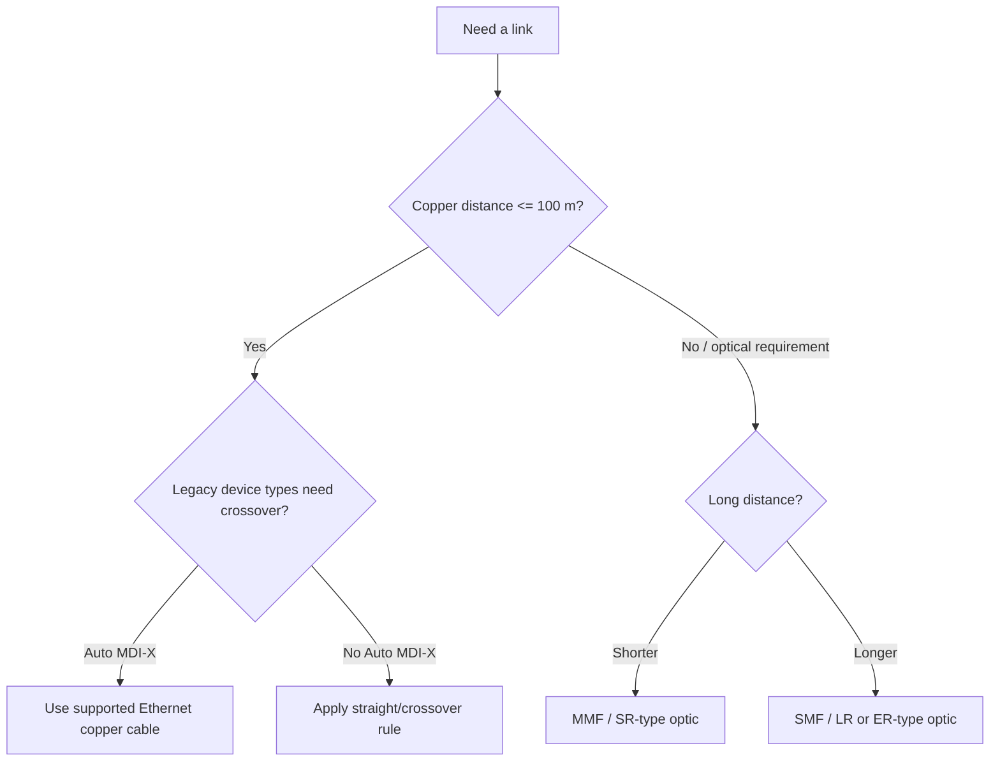

# Day 02 — Interfaces and Cables

← [[01 - Lessons/01 - Network Devices|Day 01 — Network Devices]] · [[00 - CCNA Home|CCNA Home]] · [[01 - Lessons/03 - TCP-IP and OSI Models|Day 03 — TCP-IP and OSI Models]] →

## Notebook Highlights

> [!summary] What belongs in the paper notebook
> - **RJ-45 = 8 pins.** Network speed is measured in **bits per second**.
> - Copper Ethernet maximum segment in these standards: **100 m**.
> - 10/100 Mb/s use **2 pairs**; 1G/10GBASE-T use **4 pairs**.
> - Without Auto MDI-X: **unlike devices = straight-through**, **like devices = crossover**.
> - **MMF = shorter/cheaper; SMF = longer distance.**

## Bits, Bytes, and Link Speeds

- **8 bits = 1 byte**.
- Network link rates are measured in **bits per second (b/s)**, not bytes per second.
- Decimal networking prefixes used in the course:

| Unit | Bits per second |
|---|---:|
| kilobit | 1,000 |
| megabit | 1,000,000 |
| gigabit | 1,000,000,000 |
| terabit | 1,000,000,000,000 |

## Copper Ethernet and RJ-45

**RJ-45** connectors used for common Ethernet UTP cabling have **8 pins**. UTP means **Unshielded Twisted Pair**. The wires are twisted in pairs to reduce electromagnetic interference (EMI) and crosstalk.

> [!info] Ethernet standard
> Ethernet is standardized by **IEEE 802.3** and related amendments.

### Copper standards to know

| Name | IEEE | Speed | Pairs used | Course max distance |
|---|---|---:|---:|---:|
| 10BASE-T | 802.3i | 10 Mb/s | 2 | 100 m |
| 100BASE-TX | 802.3u | 100 Mb/s | 2 | 100 m |
| 1000BASE-T | 802.3ab | 1 Gb/s | 4 | 100 m |
| 10GBASE-T | 802.3an | 10 Gb/s | 4 | 100 m |

### 10/100 Mb/s transmit and receive pairs

For traditional 10BASE-T/100BASE-TX:

- PCs, routers, and firewalls transmit on pins **1-2** and receive on **3-6**.
- Switches use the opposite pin roles.

This difference explains the historical cable rules.

### Straight-through vs crossover

> [!warning] Behavior / rule
> **Straight-through:** connects different pin-role device types, such as PC/router/firewall ↔ switch.  
> **Crossover:** historically connects the same pin-role device types, such as switch ↔ switch or router ↔ router.

**Auto MDI-X** can automatically detect the required transmit/receive orientation, so modern interfaces often work regardless of straight-through/crossover choice. You still need to recognize the traditional rules for CCNA.

## Fiber-Optic Ethernet

Fiber sends data as light rather than electrical signals. Network devices commonly use removable optical transceivers such as **SFPs**.

### Multimode vs single-mode

| Feature | MMF | SMF |
|---|---|---|
| Core | Wider | Narrower |
| Light paths | Multiple modes | Single mode |
| Typical distance | Shorter | Longer |
| Typical optic cost | Lower | Higher |
| Common use | Building/campus short links | Long campus/metro/provider links |

### Fiber standards from the course

| Standard | IEEE | Media | Course distance figure |
|---|---|---|---:|
| 1000BASE-LX | 802.3z | MMF | ~550 m |
| 1000BASE-LX | 802.3z | SMF | ~5 km |
| 10GBASE-SR | 802.3ae | MMF | ~400 m |
| 10GBASE-LR | 802.3ae | SMF | ~10 km |
| 10GBASE-ER | 802.3ae | SMF | ~30 km in the course material |

> [!note]
> Treat distance figures as study values. In production, always check the exact optic, fiber type, connector loss budget, and vendor/platform documentation.

## Copper vs Fiber

Copper UTP:
- Inexpensive and easy to terminate.
- Carries electrical signals.
- Subject to EMI and emits a small electromagnetic signal.
- Common to endpoint/access connections.

Fiber:
- Immune to electromagnetic interference.
- Supports longer distances and high speeds.
- Requires matching optics/fiber type.

## Cabling Decision Flow

> [!danger] Troubleshooting trap
> A perfectly configured interface cannot pass traffic through the wrong physical port, bad cable, unsupported optic, or excessive distance. Always verify Layer 1 before debugging higher layers.

## Active Recall

> [!question]- Check yourself
> 1. How many pins are on an RJ-45 connector?
> 2. Which pairs carry 10/100 Mb/s Ethernet?
> 3. What cable type historically connects two switches when Auto MDI-X is disabled?
> 4. Which uses all four UTP pairs: 100BASE-TX or 1000BASE-T?
> 5. Which generally supports longer distances, MMF or SMF?

> [!check]- Answers
> 1. 8.
> 2. Pins 1-2 and 3-6 (two pairs).
> 3. Crossover.
> 4. 1000BASE-T.
> 5. SMF.

## Related Notes

- [[02 - Labs/02.02 - Connecting Devices|Connecting Devices Lab]]
- [[04 - Reference/Ethernet and Cabling Reference|Ethernet & Cabling Reference]]
- [[09 - Switch Interfaces]]

## Sources

- [Jeremy's IT Lab video](https://www.youtube.com/watch?v=ieTH5lVhNaY)
- [Synchronized course transcript / chapter index](https://ccna-study-guide.vercel.app/course/jitl/3)

> [!note] Source fidelity
> These are original study notes organized from the course material, not a transcript. Course-era terminology, figures, and IOS behavior are preserved where they matter for the lesson. Platform/version-specific behavior should be verified on the device you are operating.
