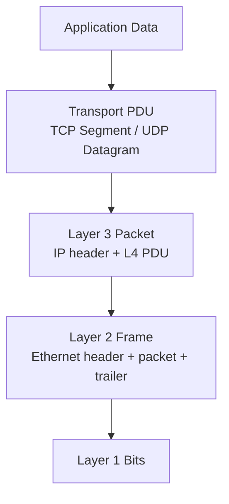

# Day 03 — TCP-IP and OSI Models

← [[01 - Lessons/02 - Interfaces and Cables|Day 02 — Interfaces and Cables]] · [[00 - CCNA Home|CCNA Home]] · [[01 - Lessons/04 - Cisco IOS CLI|Day 04 — Cisco IOS CLI]] →


## Notebook Highlights

> [!summary] What belongs in the paper notebook
> - **L1 Physical = bits/signals/media**
> - **L2 Data Link = local/hop-to-hop, Ethernet/MAC**
> - **L3 Network = IP/end-to-end networks, routers**
> - **L4 Transport = TCP/UDP, ports/process-to-process**
> - **Application = user/application protocols**
> - Encapsulation: **data → segment/datagram → packet → frame → bits**.

## Why Layered Models Exist

Networking is complex. Layering separates responsibilities so protocols and hardware can change at one layer without redesigning everything above and below it.

Important standards bodies from the lesson:
- **IEEE** — many LAN technologies, including Ethernet and Wi-Fi standards.
- **IETF** — Internet standards and protocols, published as **RFCs (Requests for Comments)**.

## Practical 5-Layer TCP/IP Model

| Layer | Name used in course | What it provides | Common identifiers/devices |
|---:|---|---|---|
| 5 | Application | Application network services/data | HTTP/DNS/etc. |
| 4 | Transport | Process-to-process delivery | TCP/UDP ports |
| 3 | Internet / Network | Host-to-host delivery across networks | IP, routers |
| 2 | Local Network / Data Link | Hop-to-hop delivery on a local link | Ethernet, MAC, switches |
| 1 | Physical | Bits over physical/wireless media | Cables, optics, signals |

### Layer 1 — Physical

Defines how **bits** are represented and moved using electrical, optical, or radio signals. It includes media, connectors, interface speeds, and physical signaling.

### Layer 2 — Local Network / Data Link

Provides local, hop-to-hop delivery. Ethernet uses **MAC addresses**, and switches forward Ethernet frames inside a LAN.

### Layer 3 — Internet / Network

Provides delivery between hosts across different networks using **IP addresses**. Routers operate here when choosing a path toward a destination network.

### Layer 4 — Transport

Provides communication between application processes using **port numbers**. TCP and UDP are the major protocols you will study.

### Layer 5 — Application

Applications and application protocols create and interpret the actual data users/services care about. In OSI terminology, the functions of the practical TCP/IP application layer overlap OSI Layers 5-7.

## OSI 7-Layer Model

From top to bottom:

| OSI Layer | Name |
|---:|---|
| 7 | Application |
| 6 | Presentation |
| 5 | Session |
| 4 | Transport |
| 3 | Network |
| 2 | Data Link |
| 1 | Physical |

The OSI protocol suite did not become the dominant Internet stack, but the **OSI model remains a standard vocabulary** for describing network functions and troubleshooting.

> [!success] Practical mapping
> TCP/IP Application ≈ OSI 5-7  
> TCP/IP Transport = OSI 4  
> TCP/IP Internet = OSI 3  
> TCP/IP Local Network = OSI 2  
> Physical = OSI 1

## Encapsulation and Decapsulation

As application data travels down the stack, each layer adds control information. The receiver removes it in reverse order.



### PDU names worth using correctly

- **TCP segment**
- **UDP datagram**
- **IP packet**
- **Ethernet frame**
- **Bits** at Layer 1

Each lower-layer PDU treats the higher-layer PDU as its **payload**.

## Same-Layer vs Adjacent-Layer Interaction

- **Adjacent-layer interaction:** one layer requests/provides services to the layer directly above or below it on the same device.
- **Same-layer interaction:** peer protocols on different devices behave as though they communicate logically at the same layer, although the data actually travels through the entire stack.

## A Useful Troubleshooting Model

When something breaks, identify the lowest layer that is not working:

```text
L1: Is there link/signal?
L2: Is the VLAN/MAC/frame path correct?
L3: Are addressing and routes correct?
L4: Are ports/protocols reachable?
L5-7: Is the application/service working?
```

> [!danger] Exam trap
> A router receives an Ethernet frame, but its routing decision is based on the **destination IP address inside the packet**. The destination MAC is only meaningful for the current Layer-2 hop.

## Active Recall

> [!question]- Check yourself
> 1. Which organization publishes RFCs?
> 2. What does Layer 2 provide: hop-to-hop or end-to-end delivery?
> 3. Which layer uses IP addresses?
> 4. What are the PDU names at L4, L3, and L2?
> 5. What happens during decapsulation?

> [!check]- Answers
> 1. IETF.
> 2. Hop-to-hop/local-link delivery.
> 3. Layer 3.
> 4. Segment/datagram, packet, frame.
> 5. The receiving stack removes lower-layer headers/trailers and passes the payload upward.

## Related Notes

- [[02 - Labs/03.02 - OSI Model - Simulation Mode|OSI Simulation Lab]]
- [[05 - Ethernet LAN Switching Part 1]]
- [[10 - IPv4 Header]]
- [[12 - Life of a Packet]]


## Sources

- [Jeremy's IT Lab video](https://www.youtube.com/watch?v=yM-XNq9ADlI)
- [Synchronized course transcript / chapter index](https://ccna-study-guide.vercel.app/course/jitl/5)

> [!note] Source fidelity
> These are original study notes organized from the course material, not a transcript. Course-era terminology, figures, and IOS behavior are preserved where they matter for the lesson. Platform/version-specific behavior should be verified on the device you are operating.
