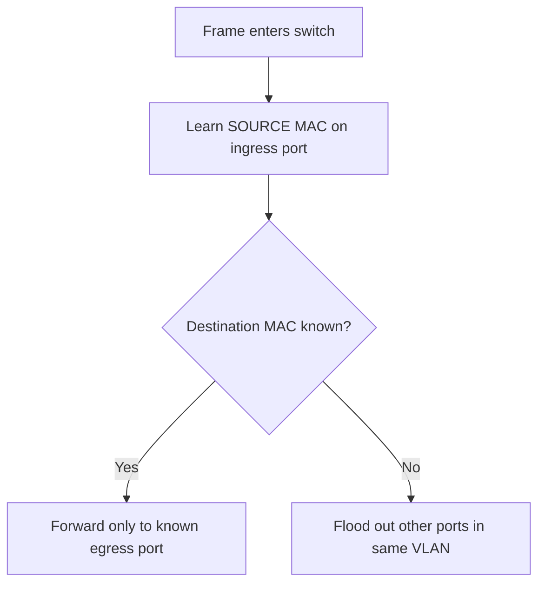

# Day 05 — Ethernet LAN Switching Part 1

← [[01 - Lessons/04 - Cisco IOS CLI|Day 04 — Cisco IOS CLI]] · [[00 - CCNA Home|CCNA Home]] · [[01 - Lessons/06 - Ethernet LAN Switching Part 2 and ARP|Day 06 — Ethernet LAN Switching Part 2 and ARP]] →


## Notebook Highlights

> [!summary] What belongs in the paper notebook
> - Ethernet switching is **Layer 2** and uses **MAC addresses**.
> - Switch learns **SOURCE MAC → incoming port**.
> - Known unicast → forward only to known port.
> - Unknown unicast → **flood** all other ports in the VLAN.
> - Dynamic MAC entries age out after **5 minutes** of inactivity in the course/default example.
> - IPv4 EtherType `0x0800`; IPv6 `0x86DD`.

## Ethernet Frame Structure

The lesson introduces the main fields a switch sees in Ethernet communication.

| Field | Size | Purpose |
|---|---:|---|
| Preamble | 7 bytes | Receiver synchronization |
| SFD | 1 byte | Start Frame Delimiter / end of preamble |
| Destination MAC | 6 bytes | Intended Layer-2 destination |
| Source MAC | 6 bytes | Sender's Layer-2 address |
| Type/Length | 2 bytes | Payload protocol type or payload length |
| Payload | variable | Encapsulated higher-layer data |
| FCS | 4 bytes | Error detection using CRC |

Preamble byte pattern:

```text
10101010
```

SFD pattern:

```text
10101011
```

### Type/Length field

- Value **≤ 1500** indicates a length.
- Value **≥ 1536** indicates an EtherType/protocol identifier.

Important EtherTypes:

```text
IPv4 = 0x0800
IPv6 = 0x86DD
```

## MAC Addresses

**MAC = Media Access Control** address.

- 48 bits = 6 bytes.
- Written as 12 hexadecimal digits.
- Often called a **BIA (Burned-In Address)** for the factory-assigned hardware address.
- The first 3 bytes are the **OUI (Organizationally Unique Identifier)** identifying the vendor allocation.

### Hexadecimal quick reminder

```text
A=10  B=11  C=12  D=13  E=14  F=15
```

## How a Switch Learns

> [!success] Core algorithm
> **Learn the source. Look up the destination. Forward or flood.**

When a frame enters a switch:

1. Read the **source MAC**.
2. Record/update `source MAC → ingress interface` in the MAC address table.
3. Look up the **destination MAC**.
4. If known, forward to the associated interface.
5. If unknown unicast, flood out all other interfaces in the same VLAN.



### Dynamic MAC addresses

A MAC learned automatically is a **dynamic MAC address**. In the default/course behavior, a dynamic entry ages out after **5 minutes of inactivity**.

> [!danger] Exam trap
> The switch does **not** learn where a destination lives by reading the destination field. It learns from the **source MAC address of frames it receives**.

## Unicast

A **unicast** frame is intended for one specific destination. It can still be flooded if the switch has not learned the destination's location yet — that is an **unknown unicast**.

## FCS and CRC

The Ethernet **FCS (Frame Check Sequence)** trailer uses a **CRC (Cyclic Redundancy Check)** calculation for error detection. A bad FCS is reflected in CRC-related interface counters.

## Active Recall

> [!question]- Check yourself
> 1. Which frame field does a switch use to learn its MAC table?
> 2. What happens to an unknown unicast?
> 3. How long is a MAC address?
> 4. What is the IPv4 EtherType?
> 5. Which Ethernet field performs error detection?

> [!check]- Answers
> 1. Source MAC.
> 2. Flooded out all other ports in the VLAN.
> 3. 48 bits / 6 bytes.
> 4. `0x0800`.
> 5. FCS, using CRC.

## Related Notes

- [[06 - Ethernet LAN Switching Part 2 and ARP]]
- [[09 - Switch Interfaces]]
- [[04 - Reference/Ethernet and Cabling Reference|Ethernet & Cabling Reference]]


## Sources

- [Jeremy's IT Lab video](https://www.youtube.com/watch?v=u2n762WG0Vo)
- [Synchronized course transcript / chapter index](https://ccna-study-guide.vercel.app/course/jitl/9)

> [!note] Source fidelity
> These are original study notes organized from the course material, not a transcript. Course-era terminology, figures, and IOS behavior are preserved where they matter for the lesson. Platform/version-specific behavior should be verified on the device you are operating.
