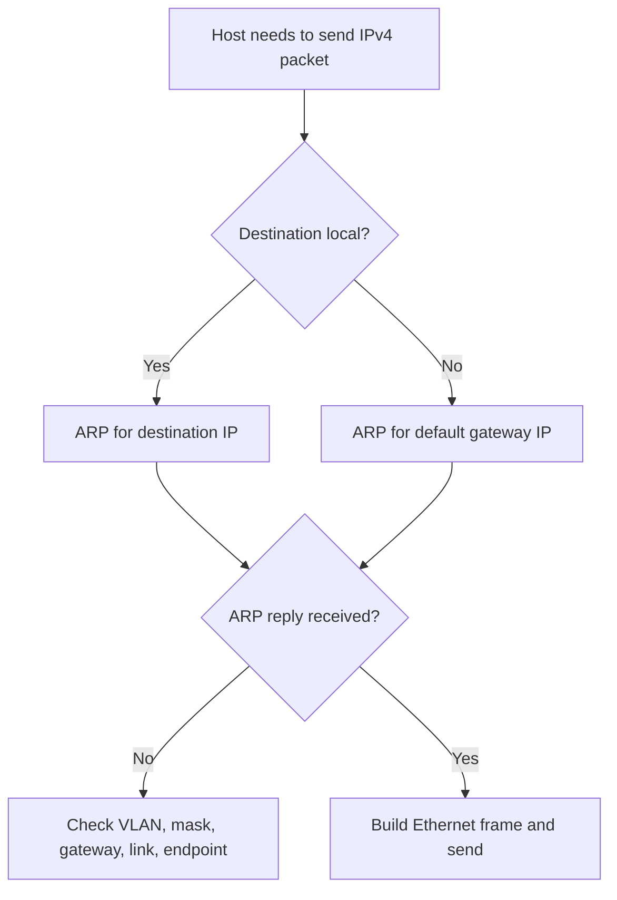

# Day 06 — Ethernet LAN Switching Part 2 and ARP

← [[01 - Lessons/05 - Ethernet LAN Switching Part 1|Day 05 — Ethernet LAN Switching Part 1]] · [[00 - CCNA Home|CCNA Home]] · [[01 - Lessons/07 - IPv4 Addressing Part 1|Day 07 — IPv4 Addressing Part 1]] →


## Notebook Highlights

> [!summary] What belongs in the paper notebook
> - Ethernet minimum frame = **64 bytes**; header+trailer (excluding Preamble/SFD) = **18 bytes**; minimum payload = **46 bytes**.
> - **ARP maps IPv4 → MAC** on the local network.
> - ARP Request = **broadcast** `FFFF.FFFF.FFFF`; ARP Reply = **unicast**.
> - Ping uses **ICMP Echo Request / Echo Reply**.
> - Remote destination? A host ARPs for the **default gateway**, not the remote host.

## Minimum Ethernet Frame Size

For the frame size calculation used in the course:

```text
Ethernet header + trailer = 18 bytes
Minimum Ethernet frame    = 64 bytes
Minimum payload           = 46 bytes
```

If the higher-layer payload is too small, Ethernet padding is used so the frame reaches the required minimum size.

## Why ARP Exists

An IPv4 host can know a destination IP address but Ethernet delivery requires a **destination MAC address** for the current local link.

**ARP (Address Resolution Protocol)** resolves:

```text
IPv4 address → MAC address
```

### Local destination

If the destination IP is in the sender's local subnet, the sender ARPs for the **destination host's MAC**.

### Remote destination

If the destination IP is outside the local subnet, the sender ARPs for the **default gateway's MAC**.

> [!danger] Critical rule
> Hosts do **not** ARP across routers for remote endpoints. ARP is a local-link mechanism.

## ARP Request and Reply

ARP Request:
- Layer-2 broadcast.
- Destination MAC: `FFFF.FFFF.FFFF`.
- Effectively asks, “Who has this IPv4 address?”

ARP Reply:
- Normally unicast back to the requester.
- Supplies the requested MAC address.

EtherType used for ARP:

```text
0x0806
```

### View ARP tables

Cisco IOS:

```cisco
show arp
```

Windows/macOS/Linux command commonly demonstrated:

```text
arp -a
```

## ARP Table vs MAC Address Table

| Table | Device/host uses it for | Maps |
|---|---|---|
| ARP table | Build local Ethernet frames for IPv4 | IPv4 → MAC |
| Switch MAC table | Forward Ethernet frames | MAC → switch interface |

These are different tables solving different problems.

## Ping and ICMP

`ping` commonly uses:

```text
ICMP Echo Request
ICMP Echo Reply
```

When tables are initially empty, a simple ping can cause several events:

```text
ARP Request → ARP Reply → ICMP Echo Request → ICMP Echo Reply
```

That is why the first ping can behave differently from later pings in a simulation/capture.

## MAC Address Table Commands

```cisco
show mac address-table
clear mac address-table dynamic
clear mac address-table dynamic address <mac-address>
clear mac address-table dynamic interface <interface-id>
```

Dynamic MAC aging in the course/default example is **5 minutes** of inactivity.

## ARP Troubleshooting Flow



> [!warning] Practical note
> A wrong subnet mask can make a host believe a remote destination is local, causing it to ARP for an address that can never answer on that LAN.

## Active Recall

> [!question]- Check yourself
> 1. What is the broadcast MAC address?
> 2. What does ARP resolve?
> 3. When sending to a remote subnet, which IP does the host ARP for?
> 4. What two ICMP messages are used by ping?
> 5. What is the difference between an ARP table and a switch MAC table?

> [!check]- Answers
> 1. `FFFF.FFFF.FFFF`.
> 2. IPv4 address to MAC address.
> 3. The default gateway's IP.
> 4. Echo Request and Echo Reply.
> 5. ARP maps IP→MAC; a switch MAC table maps MAC→switch port.

## Related Notes

- [[02 - Labs/06.02 - Analyzing Ethernet Switching|Analyzing Ethernet Switching Lab]]
- [[05 - Ethernet LAN Switching Part 1]]
- [[12 - Life of a Packet]]
- [[04 - Reference/Packet Walks|Packet Walks]]


## Sources

- [Jeremy's IT Lab video](https://www.youtube.com/watch?v=5q1pqdmdPjo)
- [Synchronized course transcript / chapter index](https://ccna-study-guide.vercel.app/course/jitl/10)

> [!note] Source fidelity
> These are original study notes organized from the course material, not a transcript. Course-era terminology, figures, and IOS behavior are preserved where they matter for the lesson. Platform/version-specific behavior should be verified on the device you are operating.
