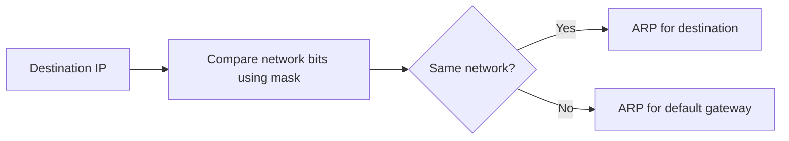

# Day 07 — IPv4 Addressing Part 1

← [[01 - Lessons/06 - Ethernet LAN Switching Part 2 and ARP|Day 06 — Ethernet LAN Switching Part 2 and ARP]] · [[00 - CCNA Home|CCNA Home]] · [[01 - Lessons/08 - IPv4 Addressing Part 2|Day 08 — IPv4 Addressing Part 2]] →


## Notebook Highlights

> [!summary] What belongs in the paper notebook
> - IPv4 = **32 bits = 4 octets**.
> - Classful defaults: **A /8, B /16, C /24**.
> - Host bits all `0` = **network address**; all `1` = **broadcast address**.
> - `127.0.0.0/8` is associated with **loopback** behavior.
> - Class D = multicast; Class E = experimental/reserved use in the classful model.

## IPv4 Address Format

An IPv4 address is **32 bits** long, written as four 8-bit **octets** in dotted-decimal notation:

```text
192.168.10.25
```

Each octet can represent decimal **0-255** because eight binary bits range from `00000000` to `11111111`.

## Binary and Decimal

Each bit in an octet has a place value:

```text
128 64 32 16 8 4 2 1
```

Example:

```text
11000000 = 128 + 64 = 192
```

This becomes essential for subnetting and masks later in [[13 - Subnetting Part 1]].

## Historical Classful Addressing

Classful addressing divided IPv4 ranges according to the first octet.

| Class | First-octet range | Leading bits | Historical default prefix | Use |
|---|---:|---|---:|---|
| A | 0-127 | `0xxxxxxx` | /8 | Unicast networks |
| B | 128-191 | `10xxxxxx` | /16 | Unicast networks |
| C | 192-223 | `110xxxxx` | /24 | Unicast networks |
| D | 224-239 | `1110xxxx` | — | Multicast |
| E | 240-255 | `1111xxxx` | — | Experimental/reserved |

Addresses beginning with **127** are used for loopback. A loopback tests the local networking software stack without sending traffic onto a physical network.

> [!note]
> Modern IP routing uses **CIDR/classless addressing**, not classful boundaries. Classful ranges remain useful historical context and still appear in CCNA learning material.

## Network and Host Portions

A prefix/subnet mask tells you which bits identify the **network** and which identify a **host/interface** inside that network.

Historical defaults:

```text
/8  = 255.0.0.0
/16 = 255.255.0.0
/24 = 255.255.255.0
```

### Network address

All host bits are `0`.

Example for `192.168.10.0/24`:

```text
Network address = 192.168.10.0
```

### Broadcast address

All host bits are `1`.

```text
Broadcast address = 192.168.10.255
```

A normal host/interface address falls between the network and broadcast addresses.

## Local-Network Thinking

The subnet mask is not decoration. A host uses its own address and mask to decide whether the destination is local or must be sent to the default gateway.



## Active Recall

> [!question]- Check yourself
> 1. How many bits and bytes are in an IPv4 address?
> 2. What is the default classful prefix for Class B?
> 3. What does an all-zero host portion identify?
> 4. What does an all-one host portion identify?
> 5. Which classful range is multicast?

> [!check]- Answers
> 1. 32 bits / 4 bytes.
> 2. /16.
> 3. Network address.
> 4. Broadcast address.
> 5. Class D (224-239 first octet).

## Related Notes

- [[08 - IPv4 Addressing Part 2]]
- [[13 - Subnetting Part 1]]
- [[04 - Reference/Subnetting Cheat Sheet|Subnetting Cheat Sheet]]


## Sources

- [Jeremy's IT Lab video](https://www.youtube.com/watch?v=3ROdsfEUuhs)
- [Synchronized course transcript / chapter index](https://ccna-study-guide.vercel.app/course/jitl/12)

> [!note] Source fidelity
> These are original study notes organized from the course material, not a transcript. Course-era terminology, figures, and IOS behavior are preserved where they matter for the lesson. Platform/version-specific behavior should be verified on the device you are operating.
