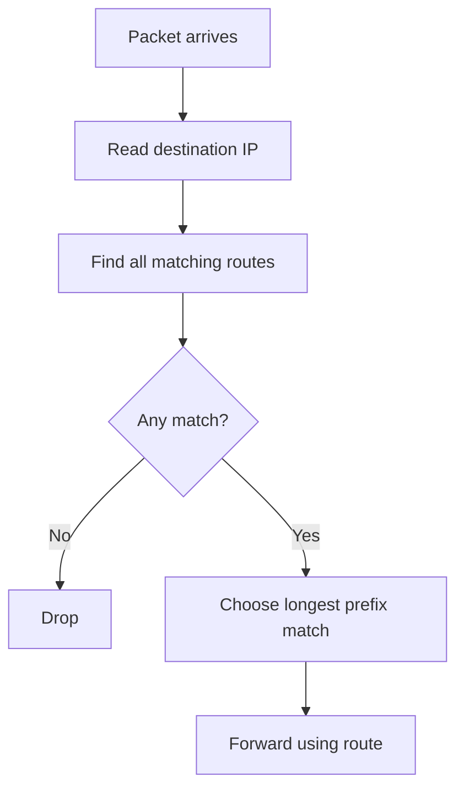

# Day 11A — Routing Fundamentals

← [[01 - Lessons/10 - IPv4 Header|Day 10 — IPv4 Header]] · [[00 - CCNA Home|CCNA Home]] · [[01 - Lessons/11B - Static Routing|Day 11B — Static Routing]] →


## Notebook Highlights

> [!summary] What belongs in the paper notebook
> - Router checks the **routing table** for the destination IP.
> - `C` = connected, `L` = local; configuring an interface IP creates both.
> - Local route = interface address as **/32**.
> - If several routes match, choose **longest prefix / most specific**.
> - No matching route → **drop packet**.

## What Routing Is

Routing is the process of forwarding a Layer-3 packet toward its destination network. Routers store known routes in a **routing table** and use the packet's **destination IP address** to choose an entry.

View the table:

```cisco
show ip route
```

Routes can come from:
- Directly connected interfaces.
- Manual **static routes**.
- **Dynamic routing protocols** such as OSPF (studied later).

The router used next in the path is the **next hop**.

## Connected and Local Routes

When you configure an IPv4 address on an up interface, IOS automatically installs two related route types.

### Connected route — `C`

Represents the network connected to the interface.

Example interface:

```text
10.40.0.1/25
```

Connected route:

```text
C 10.40.0.0/25 is directly connected, G0/0/1
```

### Local route — `L`

Represents the exact IPv4 address configured on the router interface. It uses a **/32** host route.

```text
L 10.40.0.1/32 is directly connected, G0/0/1
```

> [!success] Core concept
> **Connected = network. Local = router's own interface address.**

## Longest Prefix Match

A destination can match more than one route. The router chooses the **most specific matching route**, meaning the one with the **longest prefix length**.

Example routing table:

```text
10.0.0.0/8
10.40.0.0/16
10.40.0.0/24
```

A packet for `10.40.0.50` matches all three, but `/24` is the longest/more specific match.



## What If Nothing Matches?

If no route matches the destination, the router drops the packet — unless a default route is present, which is introduced in [[11B - Static Routing]].

## Reading `show ip route`

Important route codes at this point:

```text
C = Connected
L = Local
S = Static (next lesson)
```

Always separate these questions:

1. **Does a route exist?**
2. **Which matching route is most specific?**
3. **What next hop or exit interface will be used?**
4. **Is the outgoing interface operational?**

## Active Recall

> [!question]- Check yourself
> 1. What command displays the IPv4 routing table?
> 2. What two route types are installed automatically for a configured interface IP?
> 3. What prefix length does a local route use?
> 4. How does a router choose among multiple matching routes?
> 5. What happens if there is no matching route?

> [!check]- Answers
> 1. `show ip route`.
> 2. Connected (`C`) and local (`L`).
> 3. /32.
> 4. Longest-prefix / most-specific match.
> 5. The packet is dropped unless a default route matches.

## Related Notes

- [[11B - Static Routing]]
- [[12 - Life of a Packet]]
- [[04 - Reference/IOS Command Index|IOS Command Index]]


## Sources

- [Jeremy's IT Lab video](https://www.youtube.com/watch?v=aHwAm8GYbn8)
- [Synchronized course transcript / chapter index](https://ccna-study-guide.vercel.app/course/jitl/18)

> [!note] Source fidelity
> These are original study notes organized from the course material, not a transcript. Course-era terminology, figures, and IOS behavior are preserved where they matter for the lesson. Platform/version-specific behavior should be verified on the device you are operating.
