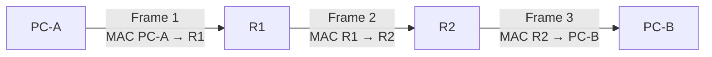

# Day 12 — Life of a Packet

← [[01 - Lessons/11B - Static Routing|Day 11B — Static Routing]] · [[00 - CCNA Home|CCNA Home]] · [[01 - Lessons/13 - Subnetting Part 1|Day 13 — Subnetting Part 1]] →


## Notebook Highlights

> [!summary] What belongs in the paper notebook
> - **IP = end-to-end; MAC = hop-to-hop.**
> - Local destination → ARP for destination host.
> - Remote destination → ARP for default gateway.
> - Router removes old L2 frame, routes on destination IP, then builds a **new L2 frame**.
> - At routed hops: **MACs change; source/destination IP normally do not; TTL decreases**.

## The Master Mental Model

> [!success] Core concept
> **IP addresses identify the end-to-end Layer-3 conversation. MAC addresses deliver the frame across the current Layer-2 hop.**

This single distinction explains a large amount of Ethernet/routing behavior.

## Step 1 — Source Host Decides Local or Remote

The source uses its own IP address and subnet mask to determine whether the destination is in the same IP network.

### If local

The host ARPs for the destination host's MAC and sends the frame directly.

### If remote

The host ARPs for its **default gateway's MAC**. The Layer-3 destination remains the remote host.

Example first-hop frame:

```text
Source MAC:      PC-A MAC
Destination MAC: R1 LAN-interface MAC
Source IP:       PC-A IP
Destination IP:  PC-B IP (remote)
```

## Step 2 — The Router Receives the Frame

The router accepts the Layer-2 frame addressed to its interface, removes the Ethernet header/trailer, and examines the enclosed IP packet.

It uses the **destination IP** for its routing-table lookup.

## Step 3 — Router Selects the Next Hop

Using longest-prefix matching, the router chooses a route. If the outgoing Layer-2 next-hop MAC is not known, the router performs ARP on that local link.

Then it creates an entirely **new Ethernet frame**.

```text
Old source/destination MACs are gone.
IP source/destination normally remain the same.
```

## Step 4 — Repeat at Every Router

Each routed hop repeats the process:



Layer-3 packet conceptually remains:

```text
Source IP = PC-A
Destination IP = PC-B
```

while Layer-2 addressing is replaced per hop.

## What Changes and What Stays the Same

| Field/item | Across normal routed hops |
|---|---|
| Source IP | Normally stays the same |
| Destination IP | Normally stays the same |
| Source MAC | Changes |
| Destination MAC | Changes |
| TTL | Decreases at each router |
| IPv4 header checksum | Changes when header changes |

NAT, tunneling, and other technologies studied later can change this simple picture, but this is the foundational model.

## Final LAN Delivery

When the final router sees the destination network as directly connected:

1. ARP for the destination host if needed.
2. Build a frame with the router interface as source MAC and destination host as destination MAC.
3. Switch forwards the frame to the destination host.

The reply performs the same logic in reverse — and therefore requires valid **return routing**.

## A Packet-Walk Checklist

At every device ask:

```text
1. What is the source/destination IP?
2. Does the sender think the destination is local or remote?
3. Which MAC address does it need for this hop?
4. Is ARP required?
5. What does the switch know about the destination MAC?
6. What route does the router choose?
7. What does the new Ethernet frame look like?
8. Is there a return route?
```

## Active Recall

> [!question]- Check yourself
> 1. For a remote destination, whose MAC does the source PC put in the first frame?
> 2. Which address does a router use for its forwarding decision?
> 3. Do MAC addresses stay the same across routers?
> 4. Do normal source/destination IPs stay the same across routers?
> 5. Why might the first packet require ARP before ICMP can be sent?

> [!check]- Answers
> 1. The default gateway's MAC.
> 2. Destination IP.
> 3. No; the Layer-2 frame is replaced hop-by-hop.
> 4. Normally yes.
> 5. The sender/router needs a destination MAC for the local Layer-2 hop.

## Related Notes

- [[02 - Labs/12.02 - Life of a Packet Lab|Life of a Packet Lab]]
- [[06 - Ethernet LAN Switching Part 2 and ARP]]
- [[11A - Routing Fundamentals]]
- [[11B - Static Routing]]
- [[04 - Reference/Packet Walks|Packet Walks]]


## Sources

- [Jeremy's IT Lab video](https://www.youtube.com/watch?v=4YrYV2io3as)
- [Synchronized course transcript / chapter index](https://ccna-study-guide.vercel.app/course/jitl/22)

> [!note] Source fidelity
> These are original study notes organized from the course material, not a transcript. Course-era terminology, figures, and IOS behavior are preserved where they matter for the lesson. Platform/version-specific behavior should be verified on the device you are operating.
