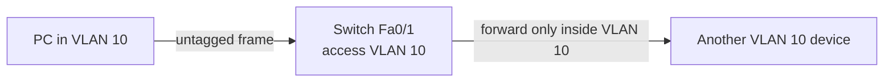

# Day 16 — VLANs Part 1

← [[01 - Lessons/15 - Subnetting Part 3 - VLSM|Day 15 — Subnetting Part 3 - VLSM]] · [[00 - CCNA Home|CCNA Home]] · [[01 - Lessons/17 - VLANs Part 2|Day 17 — VLANs Part 2]] →


## Notebook Highlights

> [!summary] What belongs in the paper notebook
> - **VLAN = separate Layer-2 broadcast domain.**
> - Layer-2 switch does **not** route between VLANs.
> - Default Cisco VLANs in the lesson: **1, 1002-1005**; switch ports default to VLAN 1.
> - **Access port = one VLAN / endpoint-facing.**
> - Create: `vlan 10`; name: `name ADMIN`; assign: `switchport mode access` + `switchport access vlan 10`.

## Broadcast Domains

A **broadcast domain** is the group of devices that receive a Layer-2 broadcast frame such as one sent to:

```text
FFFF.FFFF.FFFF
```

A flat Layer-2 LAN places many devices into the same broadcast domain. VLANs let one physical switch infrastructure act like multiple isolated Layer-2 LANs.

## Why IP Subnets Alone Are Not Enough

Assigning different IP subnets to hosts connected to the same unsegmented Layer-2 switch does not, by itself, create Layer-2 isolation. Broadcast Ethernet frames are still flooded within that broadcast domain.

**VLANs provide the Layer-2 boundary.**

> [!success] Core concept
> **One VLAN = one Layer-2 broadcast domain.** In normal design, one VLAN is also associated with one IP subnet.

## VLANs and Inter-VLAN Communication

VLANs operate at **Layer 2**. A Layer-2 switch does not route traffic from one VLAN to another.

To communicate between VLANs, you need a Layer-3 function such as:
- A router.
- A multilayer/L3 switch (studied later).

## Default VLANs

Default VLANs listed in the lesson:

```text
1, 1002, 1003, 1004, 1005
```

Switch interfaces belong to **VLAN 1 by default**.

## Access Ports

An **access port** belongs to one data VLAN and typically connects an end host such as a PC or ordinary server.

Endpoint frames on the access link are normally **untagged**.

### Create and name a VLAN

```cisco
configure terminal
vlan 10
 name ADMIN
```

### Configure an access port

```cisco
interface fastEthernet0/1
 switchport mode access
 switchport access vlan 10
```

Verify:

```cisco
show vlan brief
```

## Access-Port Packet Flow



## VLAN Design Thinking

VLANs can separate devices by purpose or security boundary, for example:

```text
VLAN 10  Administration
VLAN 20  IT
VLAN 30  Servers
```

The numbers are identifiers; the **name** gives humans context.

> [!danger] Practical trap
> An ordinary endpoint port configured as a trunk can behave unexpectedly because the endpoint usually sends untagged frames and is not acting as an 802.1Q trunk peer. Start with: **endpoint = access port; network-device uplink = often trunk**.

## Active Recall

> [!question]- Check yourself
> 1. What does a VLAN separate?
> 2. At what OSI layer do VLANs operate?
> 3. Can a Layer-2 switch route between VLANs?
> 4. What VLAN are switchports in by default in the lesson?
> 5. What two interface commands make a port a VLAN 10 access port?

> [!check]- Answers
> 1. Layer-2 broadcast domains.
> 2. Layer 2.
> 3. No.
> 4. VLAN 1.
> 5. `switchport mode access` and `switchport access vlan 10`.

## Related Notes

- [[02 - Labs/16.02 - VLANs Part 1 Lab|VLANs Part 1 Lab]]
- [[17 - VLANs Part 2]]
- [[04 - Reference/VLAN Quick Reference|VLAN Quick Reference]]


## Sources

- [Jeremy's IT Lab video](https://www.youtube.com/watch?v=cjFzOnm6u1g)
- [Synchronized course transcript / chapter index](https://ccna-study-guide.vercel.app/course/jitl/28)

> [!note] Source fidelity
> These are original study notes organized from the course material, not a transcript. Course-era terminology, figures, and IOS behavior are preserved where they matter for the lesson. Platform/version-specific behavior should be verified on the device you are operating.
