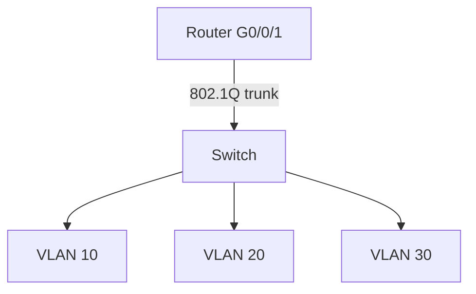

# Day 17 — VLANs Part 2

← [[01 - Lessons/16 - VLANs Part 1|Day 16 — VLANs Part 1]] · [[00 - CCNA Home|CCNA Home]]


## Notebook Highlights

> [!summary] What belongs in the paper notebook
> - **Trunk = tagged, multi-VLAN link. Access = normally untagged, one VLAN.**
> - IEEE **802.1Q** tag = **4 bytes**, inserted after Source MAC.
> - TPID **16 bits / `0x8100`**; PCP 3; DEI 1; VID identifies VLAN.
> - Usable VLAN IDs **1-4094**; normal **1-1005**, extended **1006-4094**; 0 and 4095 reserved.
> - Native VLAN default **1** and is normally **untagged** on an 802.1Q trunk.
> - ROAS = router **subinterfaces + `encapsulation dot1q` + gateway IPs**.

## Multi-Switch VLANs Need Trunks

If the same VLAN exists on more than one switch, the inter-switch connection must identify which VLAN each frame belongs to. A **trunk** carries frames for multiple VLANs across a single physical link.

Terminology:
- **Trunk port** — tagged port for multiple VLANs.
- **Access port** — normally untagged endpoint-facing port for one VLAN.

Cisco historically supported proprietary **ISL (Inter-Switch Link)**. The industry-standard trunking method is **IEEE 802.1Q (dot1q)**.

## 802.1Q Tag

The 802.1Q header is **4 bytes** and is inserted after the **Source MAC Address** field in the Ethernet frame.

### Fields to know

| Field | Bits | Meaning |
|---|---:|---|
| TPID | 16 | Tag Protocol Identifier; `0x8100` |
| PCP | 3 | Priority Code Point / Class of Service |
| DEI | 1 | Drop Eligible Indicator |
| VID | 12 | VLAN ID |

- **PCP** helps identify traffic priority/Class of Service.
- **DEI** indicates frames that may be more eligible for dropping under congestion.
- **VID** identifies the VLAN.

## VLAN ID Ranges

```text
0       reserved
1-4094  usable VLAN IDs
1-1005  normal range
1006-4094 extended range
4095    reserved
```

## Native VLAN

On an 802.1Q trunk, traffic for the **native VLAN** is normally transmitted **without an 802.1Q tag**.

Default native VLAN:

```text
VLAN 1
```

When a switch receives an **untagged** frame on a trunk, it associates that frame with the trunk's native VLAN.

> [!danger] Native VLAN mismatch
> Both trunk ends should use a compatible native VLAN. If one side considers untagged traffic VLAN 10 while the other considers it VLAN 20, traffic can be classified incorrectly.

The course recommends changing the native VLAN to an **unused VLAN** as a security best practice.

## Trunk Configuration

```cisco
interface gigabitEthernet0/1
 switchport mode trunk
```

On platforms that support/require selecting trunk encapsulation:

```cisco
switchport trunk encapsulation dot1q
```

Many newer/fixed platforms support only 802.1Q and do not expose that command.

### Allowed VLANs

```cisco
switchport trunk allowed vlan 10,20,30
```

Modify without replacing the whole list:

```cisco
switchport trunk allowed vlan add 40
switchport trunk allowed vlan remove 20
```

> [!danger] Command trap
> `switchport trunk allowed vlan 10,20,30` sets/replaces the allowed list. Use `add` or `remove` when modifying an existing list.

### Native VLAN

```cisco
switchport trunk native vlan 99
```

### Verify

```cisco
show interfaces trunk
```

Check:
- Trunk status.
- Native VLAN.
- VLANs allowed.
- VLANs active/forwarding.

## Router-on-a-Stick (ROAS)

ROAS lets one physical router interface route between multiple VLANs using **subinterfaces**.



### Parent physical interface

```cisco
interface gigabitEthernet0/0/1
 no ip address
 no shutdown
```

### VLAN 10 subinterface

```cisco
interface gigabitEthernet0/0/1.10
 encapsulation dot1q 10
 ip address 10.40.0.1 255.255.255.128
```

### VLAN 20 subinterface

```cisco
interface gigabitEthernet0/0/1.20
 encapsulation dot1q 20
 ip address 10.40.0.129 255.255.255.224
```

The subinterface number (`.10`) is a naming convention. The command that actually associates the subinterface with VLAN 10 is:

```cisco
encapsulation dot1q 10
```

## Inter-VLAN Packet Walk

```text
PC VLAN 10
  ↓ access/untagged
Switch
  ↓ trunk/tag VLAN 10
Router subinterface .10
  ↓ Layer-3 route
Router subinterface .20
  ↓ trunk/tag VLAN 20
Switch
  ↓ access/untagged
PC VLAN 20
```

The router replaces the Layer-2 frame. Normal source/destination IP addresses stay the same; MAC addresses change across the routed hop.

## Troubleshooting VLAN/Trunk/ROAS

```text
1. VLAN exists?
2. Endpoint port configured as access?
3. Correct access VLAN?
4. Trunk operational?
5. VLAN allowed on trunk?
6. Native VLAN consistent?
7. Router parent interface up?
8. Subinterface up/up?
9. Correct `encapsulation dot1q <vlan>`?
10. Correct IP/mask/default gateway?
```

Commands:

```cisco
show vlan brief
show interfaces trunk
show interfaces <interface> switchport
show ip interface brief
show mac address-table
show arp
show ip route
```

## Active Recall

> [!question]- Check yourself
> 1. How long is the 802.1Q tag?
> 2. What is the TPID value for 802.1Q?
> 3. Which 802.1Q field identifies the VLAN?
> 4. What happens to native VLAN frames on a trunk by default?
> 5. What command binds a router subinterface to a VLAN?

> [!check]- Answers
> 1. 4 bytes.
> 2. `0x8100`.
> 3. VID.
> 4. They are normally sent untagged.
> 5. `encapsulation dot1q <vlan-number>`.

## Related Notes

- [[02 - Labs/17.02 - VLANs Part 2 Lab|VLANs Part 2 Lab]]
- [[16 - VLANs Part 1]]
- [[04 - Reference/VLAN Quick Reference|VLAN Quick Reference]]
- [[04 - Reference/Packet Walks|Packet Walks]]


## Sources

- [Jeremy's IT Lab video](https://www.youtube.com/watch?v=Jl9OOzNaBDU)
- [Synchronized course transcript / chapter index](https://ccna-study-guide.vercel.app/course/jitl/30)

> [!note] Source fidelity
> These are original study notes organized from the course material, not a transcript. Course-era terminology, figures, and IOS behavior are preserved where they matter for the lesson. Platform/version-specific behavior should be verified on the device you are operating.
